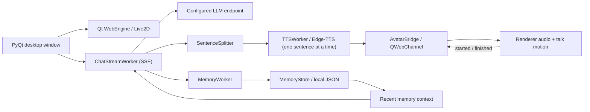

# AI Companion

[](https://github.com/Mike-stone12/ai-companion/actions/workflows/ci.yml)

**A desktop companion that remembers the conversation.**

A Windows application combining an animated Live2D character, LLM chat, bilingual voice replies, and persistent memory. The project explores how a conversational interface can retain useful facts across sessions while keeping its context compact.

**Stack:** Python · PyQt6 / Qt WebEngine · OpenAI-compatible APIs · Edge-TTS · PixiJS · Live2D

[Quick start](#quick-start) · [Memory design](#memory-design) · [Architecture](#architecture) · [Configuration](#configuration)

## What it does

- **Desktop character:** a transparent, frameless, draggable window with a Live2D avatar. Ships with two models, a whale-girl maid (default) and Hiyori, which can be swapped with one setting.
- **Window controls:** right-click the character or the drag bar for a menu with size presets (70–150 %), opacity presets (55–100 %), reset position, and quit. Position, size, and opacity are saved to `config.json` in the user data directory and restored on the next start; a saved position that is no longer on any screen (an unplugged monitor, for example) falls back to the default spot above the taskbar.
- **Chat history:** a scrollable bubble panel shows the conversation (user right, companion left, notices centered) and the current reply fills in as it streams. The conversation is saved to `history.json` in the user data directory and restored on the next start, both on screen and as context for the model.
- **Emotional expressions:** the model opens each reply with an emotion tag (`[happy]`, `[sad]`, `[angry]`, `[surprised]`, `[shy]`, `[confused]`, `[awkward]`, `[neutral]`). The tag is stripped from the stream before display and speech, and the avatar switches to the matching expression for the reply, returning to default a few seconds after it stops speaking.
- **Streaming chat:** connects to any OpenAI-compatible endpoint (Moonshot/Kimi by default, DeepSeek supported) and streams the reply, so text appears as it is generated and speech starts after the first clause instead of the whole reply. Median time from sending a message to the first spoken word dropped from 2.97 s to 1.70 s (DeepSeek `deepseek-flash`, three prompts) and no longer grows with reply length.
- **Voice replies with lip sync:** synthesizes replies with Edge-TTS, selects a Chinese or English voice based on the response, and moves the avatar's mouth with the speech volume (Web Audio analyser driving `ParamMouthOpenY`, or the model's LipSync parameter).
- **Persistent memory:** extracts short facts, saves them locally, and includes relevant and recent memories in later conversations.
- **Proactive chat (opt-in):** set `PROACTIVE_CHAT=1` for idle chat, time-of-day greetings, and spoken due reminders; off by default (`PROACTIVE_CHAT=0`). Checks run every 30 seconds. Policy blocks events during an active reply or while the input contains text, applies a two-minute grace period after a user message, and enforces cooldowns of 30 minutes for idle chat and four hours for greetings (none for reminders). Enable `CHAT_TOOLS` to set session reminders.
- **Background processing:** separate Qt workers handle chat requests, memory extraction, and speech synthesis.

## Memory design

The memory pipeline uses a lightweight extraction gate, structured LLM extraction, and a heuristic fallback:

1. **Detect useful input.** Chinese-language patterns identify personal facts, preferences, plans, and upcoming events. Common chit-chat openers are deliberately not triggers, because every extraction costs an API request.
2. **Extract candidates.** Messages that pass the gate are sent to an LLM in JSON mode. Where the provider supports it (Moonshot, DeepSeek), reasoning is turned off for this call, which makes extraction several times faster. If the LLM finds nothing worth remembering, nothing is stored. High-precision heuristics (name, identity, likes, location) are used only when the request itself fails.
3. **Queue in the background.** Extraction runs off the UI thread. Jobs queue (up to five) instead of being dropped while one is running, and rate-limited requests are retried after 10 s and 25 s.
4. **Normalize and store.** Summaries are shortened, deduplicated by exact summary text, timestamped, and stored in `memory.json` in the user data directory (see [Data flow](#data-flow)).
5. **Recall into context.** Up to eight memories are added to the next chat request alongside a bounded conversation history. With `MEMORY_RELEVANT_RECALL=1` (the default), up to half the slots prefer lexical matches to the current user message; remaining slots are filled by recency. Empty queries or no overlap fall back to selecting recent entries. Selections are returned in stored order. Setting the flag to `0` restores the previous recency-only selection in newest-first order.

Optional semantic recall is enabled with `MEMORY_SEMANTIC_RECALL=1` and an explicit `EMBEDDING_MODEL`. It uses embedding similarity for up to half the slots, then fills by recency in stored order. Embedding requests run in the chat worker with a 30-second socket timeout, and a window-session cache reuses stored memory embeddings. On failure, recall falls back to the configured `MEMORY_RELEVANT_RECALL` behavior. Enabling semantic recall sends stored memory text and the current user message to the configured API's `/embeddings` endpoint, using the same base URL and API key as chat.

With `MEMORY_CONSOLIDATION=1` (the default), new candidates are compared with stored memories, and duplicates or updates are merged instead of appended; DELETE decisions leave memories unchanged.

Older turns beyond the context window are folded in the background into a running summary, saved with chat history and included in later requests.

The store retains 24 entries by default, configurable through `MEMORY_LIMIT`. This implementation uses external, text-based memory; it does not update model weights.

### Current tradeoffs

- Extraction rules and gating are primarily designed for Chinese input.
- Default recall combines lexical overlap and recency, so paraphrases without shared words or CJK features can still be missed. Optional semantic recall requires a compatible embedding model and adds embedding request latency for uncached text.
- When consolidation is disabled or fails, exact-text deduplication does not resolve paraphrases or conflicting facts.
- Memory is added asynchronously and may become available on a later turn.

## Architecture



When proactive chat is enabled, triggers propose events, policy checks eligibility, and the engine passes at most one eligible event per tick to the composer. Its instruction is appended to conversation context for a chat request through the existing streaming and speech pipeline. Proposals that are rejected or lose priority are not queued or retried. The proactive core is pure Python; its Qt timer lives only in the UI layer (`companion/ui/main_window.py`).

Replies are streamed: `ChatStreamWorker` reads the SSE stream, shows the text as it arrives, and hands each complete sentence to `SentenceSplitter`-driven TTS. Sentences are synthesized strictly in order and queued in the renderer, which plays them back to back with a single talk gesture; the first clause is cut at a comma after a few words so speech starts early. If the stream breaks, the text received so far is kept and marked as interrupted.

Emotion tags are parsed off the start of the stream (`companion/core/chat/emotion.py`); only the leading tag is held back, so untagged replies are not delayed. The tag is kept in the conversation history sent back to the model, because without it the model imitates its own untagged replies and stops tagging after a turn or two (2/8 tagged replies vs 8/8 in an eight-turn test).

The Python application owns conversation state and worker lifecycles. Everything that does not need Qt (configuration, the LLM client, memory, model profiles) lives in `companion/core` and is tested without a GUI. The embedded HTML renderer handles the avatar and plays the synthesized speech. Python and the renderer talk over a QWebChannel object (`companion/ui/avatar_bridge.py`): Python sends play / stop / talking / motion commands, and the renderer reports when it is ready and when audio starts, finishes, or fails. The talk gesture therefore starts with the audio rather than when the request is sent, and the mouth follows the speech volume frame by frame (applied after motions and physics, right before rendering), and a two-minute watchdog resets the window if the renderer never reports back. Qt signals return worker results to the interface.

## Quick start

**Requirements:** Windows, Python 3.11+, and an API key for a compatible LLM provider. Chat and voice synthesis require network access.

Run these commands in **PowerShell**:

```powershell
git clone https://github.com/Mike-stone12/ai-companion.git
cd ai-companion
py -3.11 -m venv venv
.\venv\Scripts\python.exe -m pip install -r requirements.txt
Copy-Item .env.example .env
```

Edit `.env` with your provider's API key, endpoint, and model, then start the application:

```powershell
.\venv\Scripts\python.exe main.py
```

Using the environment's Python executable directly avoids requiring shell activation.

### Try the memory flow

1. Send a short fact such as `我喜欢咖啡`.
2. Wait for the reply and background memory extraction to finish.
3. Close and restart the application.
4. Ask `我喜欢什么饮料？` to try recall from the saved context.

Recall depends on extraction and the configured model; this is a manual walkthrough, not a benchmark result.

## Configuration

| Variable | Purpose | Default |
| --- | --- | --- |
| `OPENAI_API_KEY` | Provider API key | Required for chat |
| `OPENAI_BASE_URL` | Chat API base URL | `https://api.moonshot.ai/v1` |
| `OPENAI_MODEL` | Model identifier | `kimi-k2.6` |
| `OPENAI_TIMEOUT` | Request timeout in seconds | `60` |
| `OPENAI_RETRIES` | Request retry setting | `2` |
| `CHAT_THINKING` | Let the model reason before chat replies (Moonshot and DeepSeek only). Off is faster and keeps replies short enough to speak. | `0` |
| `CHAT_TOOLS` | Enable time and reminder tools (up to 3 model requests per turn). Reminders stay in memory for this window session; no disk persistence. | `0` |
| `PROACTIVE_CHAT` | Opt in to idle chat, time-of-day greetings, and spoken due reminders, checked every 30 seconds. Enable `CHAT_TOOLS` to set session reminders. Off creates no proactive timer or requests. | `0` |
| `LOG_LEVEL` | `DEBUG`, `INFO`, `WARNING`, or `ERROR`. Logs go to the terminal and `logs/companion.log` in the user data directory (rotated at 1 MB, 3 backups). | `INFO` |
| `EDGE_TTS_VOICE_ZH` | Chinese voice | `zh-CN-XiaoxiaoNeural` |
| `EDGE_TTS_VOICE_EN` | English voice | `en-US-AriaNeural` |
| `MEMORY_ENABLED` | Enable new memory extraction | `1` |
| `MEMORY_CONSOLIDATION` | Compare and merge candidates with stored memories; `0` restores exact-text deduplication only | `1` |
| `MEMORY_RELEVANT_RECALL` | Prefer lexical matches to the current user message, then fill by recency; `0` restores newest-first recall | `1` |
| `MEMORY_SEMANTIC_RECALL` | Enable semantic recall when an embedding model is configured; sends stored memory text and the user message to the embeddings endpoint | `0` |
| `EMBEDDING_MODEL` | Embedding model identifier; uses the chat base URL and API key. Empty disables semantic recall even when its flag is on | Empty |
| `CONVERSATION_SUMMARY` | Fold older turns into a running summary; `0` disables updates and summary context | `1` |
| `MEMORY_LIMIT` | Maximum retained memory entries | `24` |
| `COMPANION_DATA_DIR` | Where memory and logs are stored | Platform user data directory |
| `COMPANION_SYSTEM_PROMPT` | Companion's system instruction | Built-in companion prompt |
| `LIVE2D_MODEL` | Model folder under `models/` (`whale-girl`, `hiyori`) or a path to a `.model3.json` | `whale-girl` |
| `LIVE2D_VENDOR_DIR` | Optional renderer dependency directory | `vendor/` |

Variables already set in the shell take precedence over values in `.env`.

You can also add an optional `"settings"` object to `config.json` in the user data directory, alongside `"window"`, for example `"settings": {"MEMORY_LIMIT": 32, "CHAT_THINKING": true, "LOG_LEVEL": "DEBUG"}`. Keys use the environment variable names above; values may be strings, numbers, or booleans (`true` becomes `"1"`, `false` becomes `"0"`). Precedence is built-in defaults < `config.json` settings < environment variables (including `.env`). API keys and any key containing `KEY`, `SECRET`, `TOKEN`, or `PASSWORD`, as well as `COMPANION_DATA_DIR`, are ignored in this object. Loading these settings never writes to `config.json`.

`MEMORY_ENABLED=0` stops new extraction. Existing memories are still loaded into chat context by the current implementation.

## Project layout

```text
main.py                 Entry point
companion/
  core/                 Pure Python, no Qt: config, text cleanup, model profiles, window state
    chat/               Emotion tags, history, conversation summary
    llm/                API client and SSE streaming
    memory/             Store, gate, extractor, consolidation, recall, evaluation, edit helpers
    proactive/          Events, policy, triggers, composer, engine tick
    tools/              Tool registry, built-in time and reminder tools, tool-call loop
  adapters/tts_edge.py  Edge TTS synthesis and voice selection
  app/workers.py        QThread workers for chat, TTS, and memory extraction
  memory_cli.py         Read-only memory inspector
  ui/                   Main window, chat panel, avatar bridge
  qt_bootstrap.py       Windows Qt DLL setup and import diagnostics
evals/                  Offline memory evaluation cases
tests/                  pytest suite for companion/core (runs without Qt)
live2d_renderer.html     Embedded avatar renderer
.env.example            Example provider and voice settings
requirements.txt        Pinned Python dependencies
models/whale-girl/      Default model (CC BY-NC-SA 4.0, see NOTICE.md)
models/hiyori/          Alternative model (Live2D Free Material License)
vendor/                 Renderer dependencies (PixiJS 6, Cubism Core, pixi-live2d-display 0.4.0)
```

### Adding a model

Put a Cubism 4 model in its own folder under `models/` and, optionally, add a `companion.json`:

```json
{
  "model": "c_0120.model3.json",
  "window": { "width": 430, "height": 580 },
  "motions": { "talk": ["selfie"], "ambient": ["bubble", "splash"] },
  "expressions": { "happy": "expressions/开心兴奋.exp3.json", "angry": "expressions/生气.exp3.json" }
}
```

`motions.talk` lists the motion groups played when the companion starts replying, and `motions.ambient` lists the groups played occasionally while idle. The model's idle group loops automatically. `expressions` maps emotion tags to `.exp3.json` files; they are registered on the model settings in memory when the model loads, so the model files themselves stay unmodified. Emotions without a mapping (or models without `expressions`) keep the default face. Without `companion.json`, the renderer uses the first `*.model3.json` in the folder and guesses roles from group names (`Talk`/`Tap`, `Flick`). Select the model with `LIVE2D_MODEL=<folder>`.

### Data flow

User data lives outside the project, so a packaged read-only app can still write it:

| Platform | Location |
| --- | --- |
| macOS | `~/Library/Application Support/AICompanion/` |
| Windows | `%APPDATA%\AICompanion\` |
| Linux | `$XDG_DATA_HOME/ai-companion/` (default `~/.local/share/ai-companion/`) |

It holds `memory.json`, `history.json` (the last 200 turns), `config.json` (window position, size, and opacity under a `window` key), and `logs/`. On first start, a `memory.json` left in the project root by older versions is moved there; if one already exists in the data directory, neither file is touched. `.env` (secrets, ignored by Git) and the models stay in the project.

At the default `INFO` level the log records requests, memory counts, and errors but no conversation text; reply and TTS text appear only at `DEBUG`. Memories and conversation history are stored locally as plain JSON, and recalled memory text is sent to the configured LLM endpoint with chat requests. Replies are sent to Edge-TTS for speech synthesis. The renderer loads all dependencies from `vendor/` and only falls back to a version-pinned CDN copy if a local file is missing.

### Troubleshooting

- **Qt import or DLL errors:** use a fresh virtual environment and `pip install -r requirements.txt`. On Windows the startup log prints the DLL directories it added and, for Anaconda installs, whether the ICU runtime conflicts with PyQt6.
- **No character appears:** check the resource paths logged at startup (`logs/companion.log` in the data directory), or set `LIVE2D_MODEL` and `LIVE2D_VENDOR_DIR` explicitly. `LOG_LEVEL=DEBUG` also lists every renderer file it looked for.
- **Chat fails:** verify the API key, model identifier, endpoint, and network connectivity. If no reply text arrives within 30 s (an overloaded DeepSeek keeps the stream open with keep-alive comments and no content), the window gives up with "模型服务繁忙" instead of waiting; a stall of 30 s between pieces of a reply also ends it.
- **No voice on a slow network:** each sentence's speech synthesis is capped at 20 s (5 s to connect, 15 s per read). After the first failure the rest of that reply is shown as text only, so a bad connection does not stack one timeout per sentence.
- **Window in the wrong place or size:** right-click it and choose **Reset position** or a size preset. A saved position that is off every screen is ignored at startup; to discard the rest, delete the `window` section from `config.json` in the data directory.
- **Memory is not recalled:** check that extraction completed, that `memory.json` in the data directory contains the fact, and that it remains among the recent entries.

## Development

```bash
pip install -r requirements-dev.txt
ruff check .
pytest
```

The tests cover `companion/core`, which never imports PyQt or edge-tts, so they run without a display or the GUI dependencies. CI runs `ruff` and `pytest` on Ubuntu, Windows, and macOS for every pull request, with only `requirements-dev.txt` installed; a Qt import added to `companion/core` fails there.

Run the repeatable offline evaluation of the extraction gate and lexical recall with:

```bash
python -m companion.core.memory.evaluation
```

The extraction harness uses labelled Chinese cases in `evals/extraction_cases.json` and can score injected extractors fully offline. Run `python -m companion.core.memory.extraction_eval` for usage without making requests. A maintainer can explicitly run `python -m companion.core.memory.extraction_eval --live` with a configured API key; **`--live` sends the case messages to the configured LLM endpoint**. It reports store-decision accuracy, false stores, missed stores, keyword hit rate (all expected substrings found per positive case), and per-case errors. Live runs reuse the existing extractor, including its heuristic fallback on request or parse failures.

### Inspect stored memories

Use the CLI without installing the GUI dependencies:

```bash
python -m companion.memory_cli list
python -m companion.memory_cli list --limit 5
python -m companion.memory_cli search "咖啡"
python -m companion.memory_cli show 1
python -m companion.memory_cli edit 1 "Corrected memory text"
python -m companion.memory_cli edit 1 "Corrected memory text" --write
python -m companion.memory_cli --data-dir /path/to/data list
```

The default directory follows the app's settings, including `COMPANION_DATA_DIR`
from the environment or `.env`. Lists are newest first; indices are stable,
1-based positions in the stored file and also work with `show` and `edit`. Search
matches case-insensitive substrings. By default, `edit` is a dry run: it prints the
old and new summary without changing the file. Summaries use the store's whitespace
normalization and shortening. With `--write`, it first copies the original file to
`memory.json.bak` in the same directory (overwriting an older backup), then saves
the correction and updates that entry's timestamp. Invalid indices, empty text,
missing files, and exact duplicate summaries are rejected. Only `edit --write`
saves data; none of these commands migrate data.

### Edit settings

Inspect or change the editable, non-secret settings in the user data directory's
`config.json` without GUI dependencies:

```bash
python -m companion.settings_cli list
python -m companion.settings_cli show LOG_LEVEL
python -m companion.settings_cli set MEMORY_LIMIT 32
python -m companion.settings_cli set CHAT_TOOLS true --write
python -m companion.settings_cli --data-dir /path/to/data set LOG_LEVEL DEBUG --write
```

`list` and `show` report merged configuration values and their source: default,
`config.json`, or environment (highest precedence). Values use the core loader's
text representation, including `"1"`/`"0"` for stored booleans; `show` also describes
the setting's type and allowed values. For `set`, use `true`/`false` for booleans,
JSON numbers for numeric settings, and plain text for strings and choices.
By default, `set` prints the old and new stored values without changing the file.
`--write` saves atomically, creating a missing file and preserving the `window`
section and all other keys. Changes apply on the next configuration load; an
environment override is reported when editing. Directory selection follows the
memory CLI, including `COMPANION_DATA_DIR` and `.env`. Unknown, invalid, secret,
and non-editable settings (including `COMPANION_DATA_DIR`) are rejected.

## Next steps

Conflict-aware consolidation already supports ADD, UPDATE, and NOOP; DELETE decisions are ignored.

- Collect live extraction evaluation numbers; a labelled extraction harness exists, and live numbers are pending.
- Add a UI for editing stored memories; CLI inspection and editing are already available.
- Validate platforms beyond Windows.

## License and credits

The source code is released under the [MIT License](LICENSE).

Model and runtime assets are not covered by the MIT License. Full terms are in [NOTICE.md](NOTICE.md).

- **Whale girl** (default), [CC BY-NC-SA 4.0](https://creativecommons.org/licenses/by-nc-sa/4.0/), **non-commercial**. Character design by 上善无形, DeepSeek-themed maid redesign by ZipZipPipe, Live2D model by 氵六青, via [Andersen216/dsh-whale-girl-live2d](https://github.com/Andersen216/dsh-whale-girl-live2d). This is fan art; the project is not affiliated with DeepSeek.
- **Hiyori** (© Live2D Inc.), used under the Live2D Free Material License; see [`models/hiyori/LIVE2D_README.txt`](models/hiyori/LIVE2D_README.txt).

Rendering uses [PixiJS](https://github.com/pixijs/pixijs), [pixi-live2d-display](https://github.com/guansss/pixi-live2d-display), and Live2D Cubism Core.
