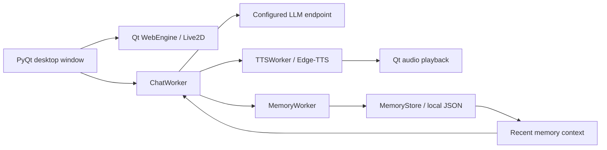

# AI Companion

**A desktop companion that remembers the conversation.**

A Windows application combining an animated Live2D character, LLM chat, bilingual voice replies, and persistent memory. The project explores how a conversational interface can retain useful facts across sessions while keeping its context compact.

**Stack:** Python · PyQt6 / Qt WebEngine · OpenAI-compatible APIs · Edge-TTS · PixiJS · Live2D

[Quick start](#quick-start) · [Memory design](#memory-design) · [Architecture](#architecture) · [Configuration](#configuration)

## What it does

- **Desktop character:** a transparent, frameless, draggable window with a Live2D avatar. Ships with two models, a whale-girl maid (default) and Hiyori, which can be swapped with one setting.
- **Configurable chat:** connects to an OpenAI-compatible chat endpoint; the default configuration uses Moonshot/Kimi.
- **Voice replies:** synthesizes replies with Edge-TTS and selects a Chinese or English voice based on the response.
- **Persistent memory:** extracts short facts, saves them locally, and includes recent memories in later conversations.
- **Background processing:** separate Qt workers handle chat requests, memory extraction, and speech synthesis.

## Memory design

The memory pipeline uses a lightweight extraction gate, structured LLM extraction, and a heuristic fallback:

1. **Detect useful input.** Chinese-language patterns identify personal facts, preferences, plans, and upcoming events. Common chit-chat openers are deliberately not triggers, because every extraction costs an API request.
2. **Extract candidates.** Messages that pass the gate are sent to an LLM in JSON mode. Where the provider supports it (Moonshot, DeepSeek), reasoning is turned off for this call, which makes extraction several times faster. If the LLM finds nothing worth remembering, nothing is stored. High-precision heuristics (name, identity, likes, location) are used only when the request itself fails.
3. **Queue in the background.** Extraction runs off the UI thread. Jobs queue (up to five) instead of being dropped while one is running, and rate-limited requests are retried after 10 s and 25 s.
4. **Normalize and store.** Summaries are shortened, deduplicated by exact summary text, timestamped, and stored in `memory.json`.
5. **Recall into context.** Up to eight recent memories are added to the next chat request alongside a bounded conversation history.

The store retains 24 entries by default, configurable through `MEMORY_LIMIT`. This implementation uses external, text-based memory; it does not update model weights.

### Current tradeoffs

- Extraction rules and gating are primarily designed for Chinese input.
- Recall uses recency, so an older relevant fact can be missed.
- Exact-text deduplication does not resolve paraphrases or conflicting facts.
- Memory is added asynchronously and may become available on a later turn.

## Architecture



The Python application owns conversation state and worker lifecycles. Everything that does not need Qt (configuration, the LLM client, memory, model profiles) lives in `companion/core` and is tested without a GUI. The embedded HTML renderer handles the avatar, while Qt signals return worker results to the interface.

## Quick start

**Requirements:** Windows, Python 3.11+, and an API key for a compatible LLM provider. Chat and voice synthesis require network access.

Run these commands in **PowerShell**:

```powershell
git clone https://github.com/Mike-stone12/ai-companion.git
cd ai-companion
py -3.11 -m venv venv
.\venv\Scripts\python.exe -m pip install -r requirements.txt
Copy-Item .env.example .env
```

Edit `.env` with your provider's API key, endpoint, and model, then start the application:

```powershell
.\venv\Scripts\python.exe main.py
```

Using the environment's Python executable directly avoids requiring shell activation.

### Try the memory flow

1. Send a short fact such as `我喜欢咖啡`.
2. Wait for the reply and background memory extraction to finish.
3. Close and restart the application.
4. Ask `我喜欢什么饮料？` to try recall from the saved context.

Recall depends on extraction and the configured model; this is a manual walkthrough, not a benchmark result.

## Configuration

| Variable | Purpose | Default |
| --- | --- | --- |
| `OPENAI_API_KEY` | Provider API key | Required for chat |
| `OPENAI_BASE_URL` | Chat API base URL | `https://api.moonshot.ai/v1` |
| `OPENAI_MODEL` | Model identifier | `kimi-k2.6` |
| `OPENAI_TIMEOUT` | Request timeout in seconds | `60` |
| `OPENAI_RETRIES` | Request retry setting | `2` |
| `CHAT_THINKING` | Let the model reason before chat replies (Moonshot and DeepSeek only). Off is faster and keeps replies short enough to speak. | `0` |
| `LOG_LEVEL` | `DEBUG`, `INFO`, `WARNING`, or `ERROR`. Logs go to the terminal and `logs/companion.log` (rotated at 1 MB, 3 backups). | `INFO` |
| `EDGE_TTS_VOICE_ZH` | Chinese voice | `zh-CN-XiaoxiaoNeural` |
| `EDGE_TTS_VOICE_EN` | English voice | `en-US-AriaNeural` |
| `MEMORY_ENABLED` | Enable new memory extraction | `1` |
| `MEMORY_LIMIT` | Maximum retained memory entries | `24` |
| `COMPANION_SYSTEM_PROMPT` | Companion's system instruction | Built-in companion prompt |
| `LIVE2D_MODEL` | Model folder under `models/` (`whale-girl`, `hiyori`) or a path to a `.model3.json` | `whale-girl` |
| `LIVE2D_VENDOR_DIR` | Optional renderer dependency directory | `vendor/` |

Variables already set in the shell take precedence over values in `.env`.

`MEMORY_ENABLED=0` stops new extraction. Existing memories are still loaded into chat context by the current implementation.

## Project layout

```text
main.py                 Entry point
companion/
  core/                 Pure Python, no Qt: config, text cleanup, LLM client,
                        memory (store, gate, extractor), model profiles
  adapters/tts_edge.py  Edge TTS synthesis and voice selection
  app/workers.py        QThread workers for chat, TTS, and memory extraction
  ui/main_window.py     The desktop window
  qt_bootstrap.py       Windows Qt DLL setup and import diagnostics
tests/                  pytest suite for companion/core (runs without Qt)
live2d_renderer.html     Embedded avatar renderer
.env.example            Example provider and voice settings
requirements.txt        Pinned Python dependencies
models/whale-girl/      Default model (CC BY-NC-SA 4.0, see NOTICE.md)
models/hiyori/          Alternative model (Live2D Free Material License)
vendor/                 Renderer dependencies (PixiJS 6, Cubism Core, pixi-live2d-display 0.4.0)
```

### Adding a model

Put a Cubism 4 model in its own folder under `models/` and, optionally, add a `companion.json`:

```json
{
  "model": "c_0120.model3.json",
  "window": { "width": 430, "height": 580 },
  "motions": { "talk": ["selfie"], "ambient": ["bubble", "splash"] }
}
```

`motions.talk` lists the motion groups played when the companion starts replying, and `motions.ambient` lists the groups played occasionally while idle. The model's idle group loops automatically. Without `companion.json`, the renderer uses the first `*.model3.json` in the folder and guesses roles from group names (`Talk`/`Tap`, `Flick`). Select the model with `LIVE2D_MODEL=<folder>`.

### Data flow

`.env`, `memory.json`, and `logs/` are ignored by Git. At the default `INFO` level the log records requests, memory counts, and errors but no conversation text; reply and TTS text appear only at `DEBUG`. Memories are stored locally as plain JSON, and recalled memory text is sent to the configured LLM endpoint with chat requests. Replies are sent to Edge-TTS for speech synthesis. The renderer loads all dependencies from `vendor/` and only falls back to a version-pinned CDN copy if a local file is missing.

### Troubleshooting

- **Qt import or DLL errors:** use a fresh virtual environment and `pip install -r requirements.txt`. On Windows the startup log prints the DLL directories it added and, for Anaconda installs, whether the ICU runtime conflicts with PyQt6.
- **No character appears:** check the resource paths logged at startup (`logs/companion.log`), or set `LIVE2D_MODEL` and `LIVE2D_VENDOR_DIR` explicitly. `LOG_LEVEL=DEBUG` also lists every renderer file it looked for.
- **Chat fails:** verify the API key, model identifier, endpoint, and network connectivity.
- **Memory is not recalled:** check that extraction completed, that `memory.json` contains the fact, and that it remains among the recent entries.

## Next steps

- Evaluate extraction and recall on a repeatable conversation set.
- Add semantic retrieval and conflict-aware memory updates.
- Add an interface for inspecting, editing, and removing stored memories.
- Validate platforms beyond Windows.

## License and credits

The source code is released under the [MIT License](LICENSE).

Model and runtime assets are not covered by the MIT License. Full terms are in [NOTICE.md](NOTICE.md).

- **Whale girl** (default), [CC BY-NC-SA 4.0](https://creativecommons.org/licenses/by-nc-sa/4.0/), **non-commercial**. Character design by 上善无形, DeepSeek-themed maid redesign by ZipZipPipe, Live2D model by 氵六青, via [Andersen216/dsh-whale-girl-live2d](https://github.com/Andersen216/dsh-whale-girl-live2d). This is fan art; the project is not affiliated with DeepSeek.
- **Hiyori** (© Live2D Inc.), used under the Live2D Free Material License; see [`models/hiyori/LIVE2D_README.txt`](models/hiyori/LIVE2D_README.txt).

Rendering uses [PixiJS](https://github.com/pixijs/pixijs), [pixi-live2d-display](https://github.com/guansss/pixi-live2d-display), and Live2D Cubism Core.
