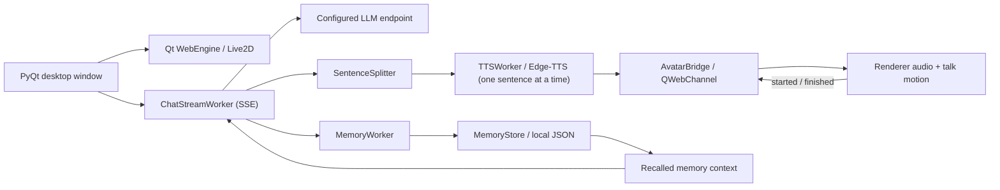

# Architecture and memory design

How AI Companion is put together. For setup see the [README](../README.md); for every setting see [configuration.md](configuration.md).

## Memory design

The memory pipeline uses a lightweight extraction gate, structured LLM extraction, and a heuristic fallback:

1. **Detect useful input.** Chinese-language patterns identify personal facts, preferences, plans, and upcoming events. Common chit-chat openers are deliberately not triggers, because every extraction costs an API request.
2. **Extract candidates.** Messages that pass the gate are sent to an LLM in JSON mode. For Moonshot and DeepSeek endpoints, the request disables reasoning. If the LLM finds nothing worth remembering, nothing is stored. Heuristics (name, identity, likes, location) are used when no API key is configured, the request fails, or the reply cannot be parsed into the expected memory list.
3. **Queue in the background.** Extraction runs off the UI thread. Up to five jobs can wait while one runs; a full queue drops the oldest pending job. Rate-limited requests are retried after 10 s and 25 s.
4. **Normalize and store.** Summaries are shortened, deduplicated by exact summary text, timestamped, and stored in `memory.json` in the user data directory (see [Data flow and privacy](#data-flow-and-privacy)).
5. **Recall into context.** Up to eight memories are added to the next chat request alongside a bounded conversation history. With `MEMORY_RELEVANT_RECALL=1` (the default), up to half the slots prefer lexical matches to the current user message; remaining slots are filled by recency. Empty queries or no overlap fall back to selecting recent entries. Selections are returned in stored order. Setting the flag to `0` restores the previous recency-only selection in newest-first order.

Optional semantic recall is enabled with `MEMORY_SEMANTIC_RECALL=1` and an explicit `EMBEDDING_MODEL`. It uses embedding similarity for up to half the slots, then fills by recency in stored order. Embedding requests run in the chat worker with a 30-second socket timeout, and a window-session cache reuses stored memory embeddings. On failure, recall falls back to the configured `MEMORY_RELEVANT_RECALL` behavior. Enabling semantic recall sends stored memory text and the current user message to the configured API's `/embeddings` endpoint, using the same base URL and API key as chat.

With `MEMORY_CONSOLIDATION=1` (the default), new candidates are compared with stored memories, and duplicates or updates are merged instead of appended; DELETE decisions leave memories unchanged.

Older turns beyond the context window are folded in the background into a running summary, saved with chat history and included in later requests.

The store retains 24 entries by default, configurable through `MEMORY_LIMIT`. This implementation uses external, text-based memory; it does not update model weights.

### Current tradeoffs

- Extraction rules and gating are primarily designed for Chinese input.
- Default recall combines lexical overlap and recency, so paraphrases without shared words or CJK features can still be missed. Optional semantic recall requires a compatible embedding model and adds embedding request latency for uncached text.
- When consolidation is disabled or fails, exact-text deduplication does not resolve paraphrases or conflicting facts.
- Memory is added asynchronously and may become available on a later turn.

## Architecture



When proactive chat is enabled, triggers propose events, policy checks eligibility, and the engine passes at most one eligible event per tick to the composer. Its instruction is appended to conversation context for a chat request through the existing streaming and speech pipeline. Proposals that are rejected or lose priority are not queued or retried. The proactive core is pure Python; its Qt timer lives only in the UI layer (`companion/ui/main_window.py`).

With `ACTIVE_APP_MONITOR=1`, the UI samples the foreground-app adapter on each proactive tick and feeds app names to the pure-Python active-app streak trigger (`companion/core/proactive/active_app.py`).

Push-to-talk routes microphone PCM through `VoiceInputController`, then finalizes and transcribes the in-memory WAV on a `TranscriptionWorker`; successful, non-empty transcripts enter the same `submit_message` path as typed chat. The local Vosk `WakeWordWorker` triggers that same capture path with a roughly five-second timer in place of button release.

Replies are streamed: `ChatStreamWorker` reads the SSE stream, shows the text as it arrives, and uses `SentenceSplitter` to hand speakable chunks to TTS. Chunks are synthesized strictly in order and queued in the renderer; the talk gesture starts when playback starts and continues across queued clips. The splitter can cut the first chunk at a comma so speech starts early. If the stream breaks, the text received so far is kept and marked as interrupted.

Emotion tags are parsed off the start of the stream (`companion/core/chat/emotion.py`); only a possible leading tag is held back. The tag is kept in the conversation history sent back to the model because without it the model imitates its own untagged replies and stops tagging after a turn or two (2/8 tagged replies vs 8/8 in an eight-turn test).

The Python application owns conversation state and worker lifecycles. `companion/core` contains configuration, the LLM client, memory, and model profiles and is tested without a GUI. The embedded HTML renderer handles the avatar and plays the synthesized speech. Python and the renderer talk over a QWebChannel object (`companion/ui/avatar_bridge.py`): Python sends play / stop / talking / motion commands, and the renderer reports when it is ready and when audio starts, finishes, or fails. The talk gesture starts with the audio, and the mouth follows the speech volume frame by frame (applied after motions and physics, right before rendering). A two-minute watchdog stops playback and discards pending audio if playback makes no progress. Qt signals return worker results to the interface.

## Persona

`companion/core/persona.py` holds the persona model. A `Persona` is plain data (name, what it calls the user, relationship, personality, speaking style, background) and `system_prompt()` renders it, followed by shared rules: speak directly to the user, stay in character, reply in the user's language, do not invent shared events, and answer honestly if sincerely asked whether it is an AI. Empty fields are left out. `PersonaProvider` supplies presets (`BuiltinPersonas` ships the default childhood friend); a preset library or imported files can implement the same protocol. `PersonaStore` keeps the active persona in `persona.json`: an unchanged preset as `{"version": 1, "preset": "<id>"}` (so improvements to the built-in text reach users who kept it), anything else in full as `{"version": 1, "persona": {...}}`, and `Persona.from_dict` validates untrusted data (types, control characters, per-field length caps), so the same format can serve import and export later. The emotion-tag instruction is appended after the persona prompt. `COMPANION_SYSTEM_PROMPT`, when set, replaces the persona prompt entirely.

Proactive instructions are sent as a user-role message, so the composer marks each one as an app note rather than something the user typed and asks for the persona's own voice, addressed to the user at the computer.

## Companion state and daily routine

`companion/core/state/` keeps the companion's own state in `state.json`: a mood (emotion and intensity) fed by the emotion tag of each reply, the time of the user's last message, and the current activity. A reply's emotion sets the mood or strengthens a matching one; one different emotion only softens a strong mood; a neutral reply calms it. The mood decays toward calm with `MOOD_HALF_LIFE_MINUTES`. After a day without a message a calm companion starts to miss the user, and that mood is kept when the user comes back. Each request gets one short system message describing the mood, the activity, and the time since the user's last message, and the idle face holds the mood's expression.

`companion/core/schedule.py` holds the daily routine stored in the persona: time blocks with an activity and a kind (`free`, `busy`, `drowsy`, `asleep`), which may cross midnight. The current block adds the activity and a hint to the state message (groggy when woken, sleepy late, brief while busy), drives the presence label in the top bar, and, while asleep, keeps every proactive trigger except reminders from being polled, so the morning greeting comes after it wakes up.

## Emotion model

Feelings follow a split between judgement and arithmetic. After an emotional turn (a keyword gate decides), one LLM request returns JSON describing what happened (praise, affection, another person, brushing off, criticism, teasing, apology, care, good news, plus how upset the user is). Deterministic rules in `companion/core/state/model.py` turn those events into changes of five feelings (joy, anger, hurt, jealousy, longing), scaled by the persona's traits (`traits.py`) and the long-term relationship (closeness, trust). Each feeling keeps up to three reasons, decays with a trait-dependent half-life, and is bounded: anger is capped at 0.8 and one turn moves a feeling by at most 0.4. An apology aimed at the actual grievance clears it; a generic one helps a little. A zero-cost keyword check runs before the reply, so a message in which the user is upset gets a caring answer at once, with grudges halved. The prompt turns the dominant feeling into behaviour by strength (a hint, the persona's style, wanting to be coaxed) and candor, always with a guardrail against guilt-tripping, threats to leave, or demanding exclusivity. `python -m companion.core.state.scenarios` replays scripted conversations under three personalities and checks the trajectories (all pass in CI).

## Diary and self memory

`companion/core/diary.py` picks the latest finished day (within three days) that had conversation and no entry, and builds one request from that day's turns, the routine, and the feeling changes, written in the persona's own voice and told not to invent anything beyond the transcript. `companion/core/memory/self_memory.py` gates replies on first-person statements and reuses the extraction and consolidation pipeline into its own store, so the user's memories and their limit are untouched. Both feed one system message built from whole lines (diary up to 420 characters, self memories filling the rest of 600).

## Pictures

`companion/core/vision.py` checks the picture's format from its content (JPEG, PNG, GIF, WebP; 8 MB; large or pasted pictures are re-encoded as JPEG at most 1568 px), sends it with the user's note as an `image_url` part in one request to the vision model, and turns the description into the user's turn, `[你发来一张图片：…]` followed by the note. History therefore stays text-only and the chat model need not read images. `service_api_key` in `companion/core/api_key.py` decides which key a separate service may receive, so the chat key never reaches another provider.
## Reply pacing

With `REPLY_PACING` on, the system message asks for one to four short chat messages, one per line. `companion/core/chat/pacing.py` splits the stream into messages as line breaks arrive; the first message also goes out at its first complete sentence or at a comma past ten characters, so a reply written as one line is spoken as early as the unpaced path. Later messages wait behind a "typing…" row for a length-based pause, and speech follows each message as it appears. History keeps one assistant message per reply. The companion's dominant feeling also shifts the Chinese voice slightly (annoyed: quicker and lower; sad: slower; happy: brighter).

## Project layout

```text
main.py                           Entry point (also handles --self-test)
ai-companion.spec                 PyInstaller build: macOS .app, Windows/Linux one-folder
companion/
  core/                           Pure Python, no Qt: config, text cleanup, model profiles, window state
    api_key.py                    API key from the OS keychain (keyring, lazy) or .env/environment
    persona.py                    Persona data, presets provider, persona.json store, system prompt
    schedule.py                   Daily routine blocks, text format, current block, presence label
    state/                        Companion mood, decay, last contact, state.json, prompt summary
    settings_file.py              JSON loading and atomic writes
    settings_form.py              GUI-independent settings form model with validation and staged edits
    settings_schema.py            Editable settings metadata, validation, and persistence
    settings_values.py            Merge config.json settings with environment overrides
    legacy_data.py                Migrate legacy memory.json at startup
    voice_input.py                Push-to-talk capture model and WAV encoder (no microphone access)
    voice_input_controller.py     Capture and transcription session controller (no Qt)
    wake_word.py                  Pure-Python wake-word matcher
    wake_word_controller.py       Wake-word listening session controller (no Qt)
    chat/                         Emotion tags, history, conversation summary
    llm/                          API client, SSE streaming, embeddings
      transcription.py            OpenAI-compatible speech transcription client
    memory/                       Store, extraction, consolidation, lexical/semantic recall, cache, evals, edits
      browser.py                  GUI-independent memory browser model with search and staged edits
    proactive/                    Events, policy, triggers (including active_app.py), composer, engine tick, session adapter
    tools/                        Tool registry, built-in time and reminder tools, tool-call loop
  adapters/tts_edge.py            Edge TTS synthesis and voice selection
  adapters/active_app.py          Foreground-app name adapter (Windows and macOS)
  adapters/microphone.py          Qt microphone capture emitting PCM in memory
  adapters/wake_word_vosk.py      Optional local Vosk wake-phrase recognizer
  app/workers.py                  Qt workers for chat, transcription, TTS, memory, and summary
  app/wake_word_worker.py         Qt worker for local wake recognition on a dedicated thread
  app/logging_setup.py            Console and rotating file logging
  memory_cli.py                   Memory inspection and editing (dry run unless --write)
  settings_cli.py                 Non-secret settings inspection and editing
  paths.py                        Resource paths and platform user data directories
  env.py                          Load .env while preserving shell overrides
  ui/                             Main window, chat panel, avatar bridge
    settings_dialog.py            Qt settings dialog bound to the settings form model
    memory_dialog.py              Qt memory dialog bound to the memory browser model
    persona_dialog.py             Qt persona dialog (first start and Persona… menu)
  qt_bootstrap.py                 Windows Qt DLL setup and import diagnostics
  self_test.py                    Offline --self-test checks (window half in ui/self_test.py)
evals/                            Offline memory evaluation cases
tests/                            Core, adapter, and CLI tests (runs without Qt)
docs/                             Configuration, architecture, and development guides
live2d_renderer.html              Embedded avatar renderer
.env.example                      Example provider and voice settings
requirements.txt                  Pinned Python dependencies
requirements-dev.txt              pytest and ruff for development and CI
models/whale-girl/                Default model (CC BY-NC-SA 4.0, see NOTICE.md)
models/hiyori/                    Alternative model (Live2D Free Material License)
vendor/                           Renderer dependencies (PixiJS 6, Cubism Core, pixi-live2d-display 0.4.0)
```

## Adding a model

Put a Cubism 4 model in its own folder under `models/` and, optionally, add a `companion.json`:

```json
{
  "model": "c_0120.model3.json",
  "window": { "width": 430, "height": 580 },
  "motions": { "talk": ["selfie"], "ambient": ["bubble", "splash"] },
  "expressions": { "happy": "expressions/开心兴奋.exp3.json", "angry": "expressions/生气.exp3.json" }
}
```

`motions.talk` lists the motion groups played when speech playback starts, and `motions.ambient` lists the groups played occasionally while idle. The model's idle group loops automatically. `expressions` maps emotion tags to `.exp3.json` files; they are registered on the model settings in memory when the model loads, so the model files themselves stay unmodified. Emotions without a mapping (or models without `expressions`) keep the default face. Without `companion.json`, Python selects the first `*.model3.json` in sorted filename order and the renderer guesses roles from group names (`Talk`/`Tap`, `Flick`). Select the model with `LIVE2D_MODEL=<folder>`.

## Data flow and privacy

User data lives outside the project, so a packaged read-only app can still write it:

| Platform | Location |
| --- | --- |
| macOS | `~/Library/Application Support/AICompanion/` |
| Windows | `%APPDATA%\AICompanion\` |
| Linux | `$XDG_DATA_HOME/ai-companion/` (default `~/.local/share/ai-companion/`) |

It holds `memory.json`, `history.json` (up to 200 individual user/assistant messages plus an optional running summary), `config.json` (window position, size, and opacity under `window`, and optional app settings under `settings`), `persona.json` (the active persona), `state.json` (the companion's feelings and last contact), `diary.json` (its diary), `self_memory.json` (its memories about itself), `reminders.json` (persistent reminders, loaded and saved only with `CHAT_TOOLS` enabled), and `logs/`. Reminders are saved atomically when changed; overdue reminders remain eligible for the existing proactive checks after restart. A corrupt or unreadable reminder file is logged and treated as empty without changing it until a valid change; save errors are logged without interrupting chat. At startup, a `memory.json` left in the project root by older versions is moved there; if one already exists in the data directory, neither file is touched. `.env` (secrets, ignored by Git) and the models stay in the project.

Routine `INFO` logs record requests and memory counts; TTS text is logged at `DEBUG`. Error logs may include provider error details. Memories and conversation history are stored locally as plain JSON, and recalled memory text is sent to the configured LLM endpoint with chat requests. Replies are sent to Edge-TTS for speech synthesis. The renderer loads PixiJS and Cubism Core locally and tries the local `cubism4.min.js` bundle before version-pinned CDN copies if that bundle fails to load or initialize.

Recorded push-to-talk and post-wake captures are sent as WAV audio to the configured transcription endpoint (`/audio/transcriptions` under the chat base URL), using the chat API key and `TRANSCRIPTION_MODEL`. Wake-phrase detection itself runs locally through Vosk; audio used only for wake listening is not sent to a service. Microphone audio and captured WAV bytes stay in memory and are not written to disk by the app. Successful transcripts follow normal chat submission and history storage.
